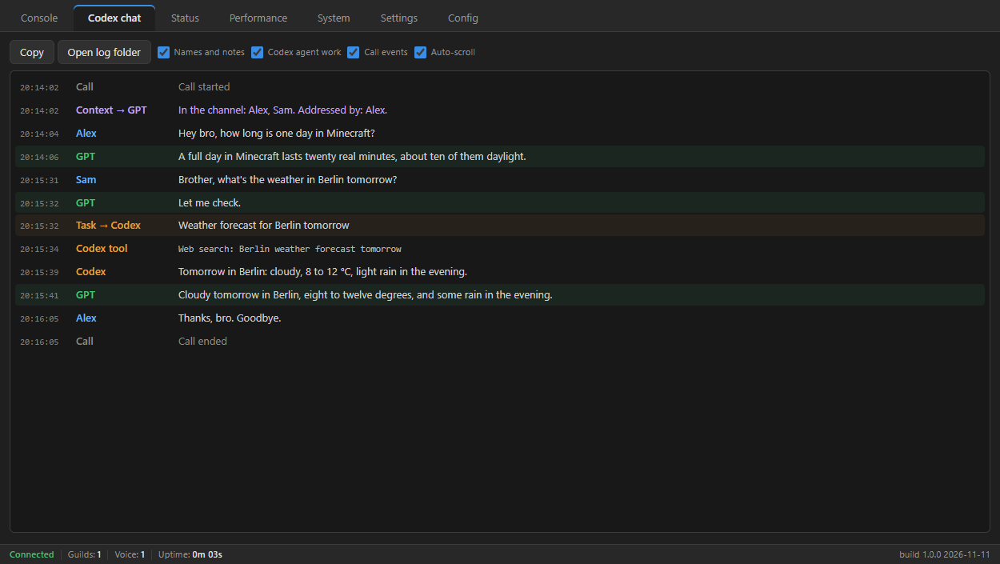

<h1 align="center">VoiceBro</h1>

<p align="center">
  <b>An AI voice assistant for your Discord voice channel.</b><br>
  Say a wake phrase, ask out loud and hear the answer while you keep playing.
</p>

<p align="center">
  <a href="https://github.com/OldSlash/voicebro-discord/releases/latest">Download</a> ·
  <a href="#quick-start">Quick start</a> ·
  <a href="docs/user-guide.md">User guide</a> ·
  <a href="#limitations">Limitations</a> ·
  <a href="#building-from-source">Building from source</a> ·
  <a href="#license">License</a>
</p>

<p align="center">
  
</p>

## Features

- **Hands-free.** An offline wake word starts a session, so you never leave the game.
  Ten languages to choose from (English, Russian, Czech, Dutch, French, German, Italian,
  Polish, Portuguese, Spanish), each downloaded only after you agree; any other Vosk model
  can be added by hand.
- **A real voice.** ChatGPT's voice through the official Codex CLI, with your own ChatGPT
  account. No API key.
- **Looks things up.** Questions that need research go to Codex, which can search the web,
  and the answer comes back by voice.
- **Built for gaming.** Mute with a system-wide hotkey, from the app or from a button in
  Discord. While nobody uses `/join`, nothing of the assistant runs.
- **Keeps to itself.** The wake word is recognized on your PC and nothing reaches the
  assistant between sessions. The app keeps all its files in its own folder.

## Requirements

- Windows 10 or 11, 64-bit
- A Discord server where you can add a bot
- A ChatGPT account with access to Codex

## Download

Get the latest version from [Releases](https://github.com/OldSlash/voicebro-discord/releases/latest):

| File | For |
|---|---|
| `VoiceBro_<version>_x64-setup.exe` | Installing with a Start menu entry. No administrator rights needed. |
| `VoiceBro_<version>_x64-portable.zip` | Running from any folder without installing. |

> [!NOTE]
> Releases are not code-signed yet, so Windows SmartScreen may warn about an unknown
> publisher. Choose **More info**, then **Run anyway**. `SHA256SUMS.txt` in each release
> lets you check the files.

## Quick start

1. **Create a Discord bot** in the [Developer Portal](https://discord.com/developers/applications):
   copy its token and invite it to your server with the scopes `bot` and
   `applications.commands` and the permissions View Channels, Connect, Speak, Send Messages
   and Embed Links.
   ([Step by step](docs/user-guide.md#1-create-the-discord-bot))
2. **Connect it.** Start VoiceBro, paste the token into **Config → Discord bot token** and
   press **Save changes**.
3. **Set up Codex.** On the **Status** tab press **Install Codex** if it is missing, then
   **Sign in to Codex** and finish the ChatGPT sign-in in your browser.
4. **Choose a wake phrase.** In **Settings → Assistant**, pick the wake model for your
   language, enter a phrase such as `hey bro`, and press **Download** when VoiceBro asks for
   the speech model.
5. **Talk.** Join a voice channel, type `/join`, say your phrase and ask a question.

The [user guide](docs/user-guide.md) covers each step in detail, as well as other
languages, settings, privacy, updating, uninstalling and troubleshooting.

## Limitations

- **The voice comes only from OpenAI's Codex.** VoiceBro has no voice engine of its own:
  the assistant listens and speaks through the Codex CLI with your ChatGPT sign-in. Without
  Codex, a ChatGPT account with access to it and a connection to OpenAI, the assistant
  cannot answer. Only the wake word works offline.
- **The voice needs a low ping to the Discord voice server.** VoiceBro sends the
  assistant's voice to Discord from the PC it runs on, so it works best when that PC has a
  low ping to the voice channel's server. At a very high ping, around 300 ms or more, the
  voice can stutter in places. We saw it ourselves: at a ping of about 30 ms the voice was
  clean, at 300–380 ms it broke up. How much other setups are affected is not known yet.
  If you hear it, set the channel's **Region Override** (**Edit Channel → Overview**) to a
  region close to the PC that runs VoiceBro.

## Building from source

VoiceBro is written in Rust with [Tauri 2](https://v2.tauri.app). It builds on Windows.

### Prerequisites

| Tool | Version | Notes |
|---|---|---|
| [Rust](https://rustup.rs) | stable, 1.89 or newer | The default MSVC toolchain (`x86_64-pc-windows-msvc`). |
| [Visual Studio 2022 Build Tools](https://visualstudio.microsoft.com/visual-cpp-build-tools/) | 2022 | The **Desktop development with C++** workload, which brings MSVC, a Windows SDK and CMake. |
| [Tauri CLI](https://v2.tauri.app/reference/cli/) | 2.x | Only for the installer: `cargo install tauri-cli --version "^2" --locked` |

The voice codec, [Opus](https://opus-codec.org), is a C library that is compiled from source
during the build, with CMake. The build finds CMake on `PATH`, or by itself inside a full
Visual Studio. Pick one of these:

- **Developer PowerShell for VS 2022** (recommended). Open it from the Start menu and run the
  commands below in it. It puts the compiler and the CMake that came with the Build Tools on
  `PATH`, so there is nothing else to install.
- **CMake on its own.** `winget install Kitware.CMake` installs it for all users and adds it
  to `PATH`; it asks for administrator rights. After that, any new PowerShell window works.
- **Visual Studio 2022 Community** with the same workload instead of the Build Tools. The
  build then finds its CMake without `PATH`.

### Build, test and run

```powershell
git clone https://github.com/OldSlash/voicebro-discord.git
cd voicebro-discord
cargo build                     # the whole workspace
cargo test                      # the tests; no Discord account or Codex needed
cargo run -p voicebro-desktop   # start the app (debug build)
```

The app keeps its files next to its executable, here `target\debug\`. Set
`VOICEBRO_DATA_DIR` to another folder to keep test data apart.

### Installer and portable zip

```powershell
powershell -ExecutionPolicy Bypass -File scripts\build-release.ps1 -Trial
```

This writes a test installer, the portable zip and their checksums to
`target\release\dist-trial\`. Without `-Trial`, the script builds a release only from
`main` at a tag `v<version>` that matches the app's version.

### Repository layout

| Path | Contents |
|---|---|
| `crates/voicebro-core` | The app's core: Discord voice, the wake word, the ChatGPT call through Codex, settings. No UI. |
| `apps/desktop` | The Tauri app: the window, its commands and the installer configuration. |
| `apps/probe` | Developer probes that check the external APIs live. |
| `scripts/` | The release build, the third-party notices and test helpers. |
| `docs/` | The architecture description and the user guide. |
| `openspec/` | Specifications and the record of changes. |

Read [docs/ARCHITECTURE.md](docs/ARCHITECTURE.md) before changing code.

## Built with

| Component | What it does in VoiceBro | License |
|---|---|---|
| [Tauri 2](https://v2.tauri.app) and Microsoft [WebView2](https://developer.microsoft.com/microsoft-edge/webview2/) | The window. WebView2's loader is built in; the runtime comes with Windows or the installer. | Apache-2.0 or MIT; WebView2 SDK: Microsoft's BSD-style license |
| [tokio](https://tokio.rs) | Runs the app's network and background work. | MIT |
| [serenity](https://github.com/serenity-rs/serenity) | The Discord bot: connection and slash commands. | ISC |
| [songbird](https://github.com/serenity-rs/songbird) and [davey](https://github.com/Snazzah/davey) | Discord voice, with Discord's end-to-end encryption (DAVE). | ISC; MIT |
| [Opus](https://opus-codec.org), through [opus2](https://github.com/cijiugechu/opus2) | Encodes and decodes the voice. The C library is compiled into the app. | BSD-3-Clause; MIT or Apache-2.0 |
| [webrtc-rs](https://github.com/webrtc-rs/webrtc) | The voice call to ChatGPT. | MIT or Apache-2.0 |
| [Vosk](https://alphacephei.com/vosk/) | The offline wake word. Downloaded with the model of your language after you agree. | Apache-2.0; the Czech model MIT |
| [Codex CLI](https://github.com/openai/codex) | The assistant: the ChatGPT sign-in, the voice call and the web search. Installed separately. | Apache-2.0 |
| [NSIS](https://nsis.sourceforge.io) | The installer. | zlib/libpng |

These are the main parts. `THIRD-PARTY-NOTICES.txt`, which comes with the installer and the
zip, lists everything with the full license texts: every Rust crate in `voicebro.exe`, the
native libraries inside them, the installer's components, what is downloaded after your OK
and what VoiceBro needs but does not ship. `scripts\third-party-notices.ps1` writes it.

## License

VoiceBro is released under the [MIT License](LICENSE).
Copyright (c) 2026 Aleksandr Bogdanov.

The third-party software it is built with keeps its own licenses; see
[Built with](#built-with).

VoiceBro is an independent project and is not affiliated with Discord or OpenAI.

## Acknowledgements

VoiceBro was inspired by [GPTVoice](https://github.com/mutedvector/gptvoice-discord) by
[mutedvector](https://github.com/mutedvector) and its idea: talk to ChatGPT's voice in a
Discord channel directly, through a ChatGPT subscription, unlike the bots that need an API
key.
