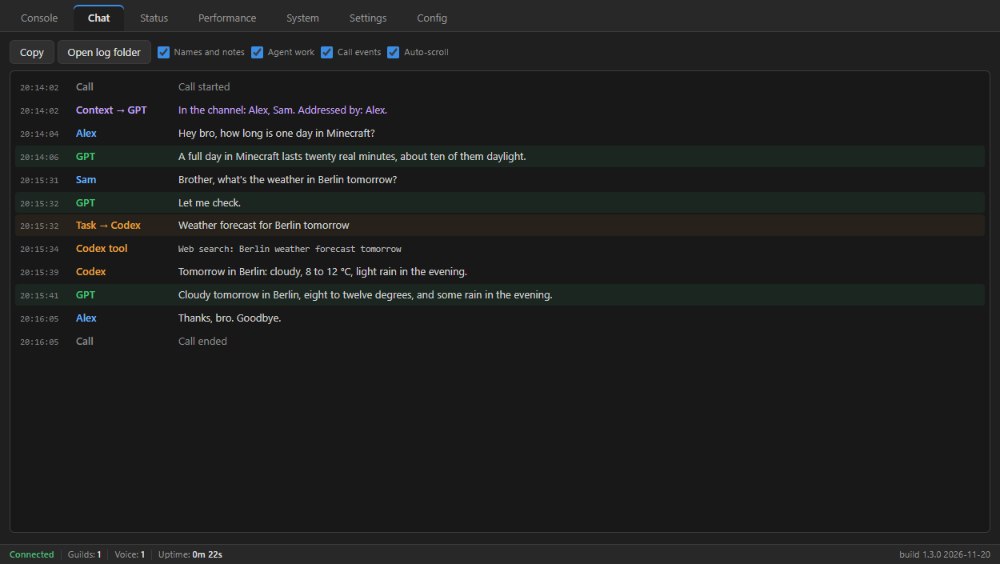

<h1 align="center">VoiceBro</h1>

<p align="center">
  <b>An AI voice assistant for your Discord voice channel.</b><br>
  Say a wake phrase, ask out loud and hear the answer while you keep playing.
</p>

<p align="center">
  <a href="https://github.com/OldSlash/voicebro-discord/releases/latest">Download</a> ·
  <a href="#quick-start">Quick start</a> ·
  <a href="docs/user-guide.md">User guide</a> ·
  <a href="#limitations">Limitations</a> ·
  <a href="#native-headless-mode">Headless</a> ·
  <a href="#building-from-source">Building from source</a> ·
  <a href="#license">License</a>
</p>

<p align="center">
  
</p>

## Features

- **Hands-free.** An offline wake word starts a session, so you never leave the game.
  Ten languages to choose from (English, Russian, Czech, Dutch, French, German, Italian,
  Polish, Portuguese, Spanish), each downloaded only after you agree; any other Vosk model
  can be added by hand.
- **A real voice.** ChatGPT's voice through the official Codex CLI, with your own ChatGPT
  account. No API key.
- **Or keep the speech on your PC.** In the second mode, Whisper, speech is turned into text
  on your PC (on the CPU or an NVIDIA GPU), the assistant answers the text, and a local voice
  reads the answer into the channel. Only text leaves your PC. Models and voices are
  downloaded after you agree. ([Whisper mode](docs/user-guide.md#7-the-whisper-mode))
- **Or read the answers.** A third mode, Whisper with text answers, works like the Whisper
  mode but posts each answer as text in Discord instead of speaking it.
  ([Text answers](docs/user-guide.md#text-answers))
- **Three engines.** Codex is the default. In the Whisper modes the answers can also come
  from [Claude Code](https://code.claude.com) with your Claude sign-in or an API key, or
  from [OpenCode](https://opencode.ai) with the AI providers you set up in it. You switch in
  Config → Assistant, also while the bot is in a channel.
- **Looks things up.** Questions that need research go to the engine, which can search the
  web, and the answer comes back by voice. If you like, the full answer is also posted as
  text in a Discord channel of your choice, with its links and their previews.
- **Built for gaming.** Mute with a system-wide hotkey, from the app or from a button in
  Discord. While nobody uses `/join`, nothing of the assistant runs.
- **Keeps to itself.** The wake word is recognized on your PC and nothing reaches the
  assistant between sessions. The app keeps all its files in its own folder.
- **Your subscription, your voice.** Optionally, link your own Discord account once with a
  one-time code, and only your voice reaches the assistant. Everyone can still bring the bot
  in and hear the answers.

## Requirements

For the desktop app; see [Native headless mode](#native-headless-mode) for the console binary.

- Windows 10 or 11, 64-bit
- A Discord server where you can add a bot
- One of the engines:
  - a ChatGPT account with access to Codex (the realtime voice and the Whisper modes; see
    [Your ChatGPT account and OpenAI's terms](#your-chatgpt-account-and-openais-terms));
  - Claude Code with a Claude account or an Anthropic API key (the Whisper modes; see
    [A Claude subscription is yours alone](#a-claude-subscription-is-yours-alone));
  - OpenCode with an AI provider set up in it (the Whisper modes).

## Download

Get the latest version from [Releases](https://github.com/OldSlash/voicebro-discord/releases/latest):

| File | For |
|---|---|
| `VoiceBro_<version>_x64-setup.exe` | Installing with a Start menu entry. No administrator rights needed. |
| `VoiceBro_<version>_x64-portable.zip` | Running from any folder without installing. |

> [!NOTE]
> Releases are not code-signed yet, so Windows SmartScreen may warn about an unknown
> publisher. Choose **More info**, then **Run anyway**. `SHA256SUMS.txt` in each release
> lets you check the files.

## Quick start

1. **Create a Discord bot** in the [Developer Portal](https://discord.com/developers/applications):
   copy its token and invite it to your server with the scopes `bot` and
   `applications.commands` and the permissions View Channels, Connect, Speak, Send Messages
   and Embed Links.
   ([Step by step](docs/user-guide.md#1-create-the-discord-bot))
2. **Connect it.** Start VoiceBro, paste the token into **Config → Discord bot token** and
   press **Save changes**.
3. **Set up the engine.** On the **Status** tab press **Install Codex** if it is missing,
   then **Sign in to Codex** and finish the ChatGPT sign-in in your browser. For Claude Code
   or OpenCode, pick it in **Config → Assistant → Engine** first, then **Install** and
   **Sign in to Claude Code**, or set up a provider in OpenCode.
   ([Set up the engine](docs/user-guide.md#4-set-up-the-engine))
4. **Choose a wake phrase.** In **Config → Assistant**, pick the wake model for your
   language, enter a phrase such as `hey bro`, and press **Download** under **Wake model**
   for the speech model, or download its files yourself from the linked pages. With Claude
   Code or OpenCode (the Whisper mode) press **Download** in **Settings → Whisper** and
   **Settings → Local voice** instead; the Whisper mode's phrases are `bro` and `peace out`
   until you change them.
5. **Talk.** Join a voice channel, type `/join`, say your phrase and ask a question.

The [user guide](docs/user-guide.md) covers each step in detail, as well as other
languages, the Whisper mode, settings, privacy, updating, uninstalling and troubleshooting.

## Your bot, your rules

VoiceBro runs a Discord bot that you create, so Discord's developer terms apply to you as
its owner. VoiceBro gives you optional tools for them; using them is your choice:

- **Who the assistant hears** (Config → Access): everyone in the channel (the default),
  only people who agreed with `/optin`, or only your own linked Discord account.
- **`/optin`, `/optout` and `/privacy`**: people agree, withdraw and read your privacy
  policy in Discord; the Access card lists who agreed and can remove them.
- **A privacy policy template**: [docs/PRIVACY-POLICY-TEMPLATE.md](https://github.com/OldSlash/voicebro-discord/blob/main/docs/PRIVACY-POLICY-TEMPLATE.md).
  Fill it in, publish it, and put its address into the Access card and into your
  application in the Discord Developer Portal.

The [user guide](docs/user-guide.md#who-the-assistant-hears) explains each of them.

The account behind the engine has its own terms too. VoiceBro is open source and enforces
none of them, nor could it: it shows what they say and offers a switch, and whether to use
it is up to you.

**Within both OpenAI's and Anthropic's terms:** the Whisper modes on your own account or
subscription, with your Discord account linked and **Only my Discord account** on. Only you
talk to the engine, with your own account and through the engine's own sign-in, and a local
voice reads the answer or it is posted as text: ChatGPT's voice is not used.

### Your ChatGPT account and OpenAI's terms

Codex answers with your ChatGPT account. VoiceBro hands that account to nobody and saves
nothing of ChatGPT's voice to a file. OpenAI's terms neither clearly forbid nor clearly
allow the way VoiceBro uses the account.

What they say: for Free, Go, Plus and Pro,
[OpenAI's Terms of Use](https://openai.com/policies/terms-of-use/) do not let you share your
sign-in or make your account available to anyone else; for Business and Enterprise, the
[OpenAI Services Agreement](https://openai.com/policies/services-agreement/) gives each user
account to one person and does not let users share a login. In the realtime voice mode the
assistant speaks with ChatGPT's voice, and for every plan
[OpenAI's Service Terms](https://openai.com/policies/service-terms/) (section 8) allow it for
non-commercial use only and do not allow distributing or repackaging it as a standalone audio
recording or other sound file. The Whisper modes do not use ChatGPT's voice: a local voice on
your PC reads the answer, or it is posted as text.

The reading here is that VoiceBro's use does not break these terms, but it may be wrong:
OpenAI has not said what making an account available covers, and its terms clearly rule out
saving ChatGPT's voice to a file, but not clearly a live stream of it into a Discord
channel. Do not record what the assistant says and publish it, in a clip, a stream or
otherwise.

To be on the safe side, choose **Only my Discord account** in Config → Access: then only
your own voice reaches Codex, and everyone still hears the answers and can use the bot's
commands. VoiceBro shows this notice in the Codex card with **Hear only me**, which switches
for you, and **Hide**, which puts it away for good; the headless app prints it once at start.
An OpenAI API key, Amazon Bedrock or Google Cloud sign-in, set up in Codex outside VoiceBro,
falls under other terms, and VoiceBro shows no notice for it. VoiceBro never reads, stores or
passes your OpenAI credentials: you sign in through Codex itself.
The [user guide](docs/user-guide.md#your-chatgpt-account-and-openais-terms) quotes the terms.

### A Claude subscription is yours alone

If Claude Code answers with a Claude subscription, that subscription is for you alone. For
Free, Pro, Max and Ultra, [Anthropic's Consumer Terms](https://www.anthropic.com/legal/consumer-terms)
do not let you share your sign-in or make your account available to anyone else; Team and
Enterprise fall under [Anthropic's Commercial Terms](https://www.anthropic.com/legal/commercial-terms)
and your organization's agreement. For every plan,
[Claude Code's legal page](https://code.claude.com/docs/en/legal-and-compliance) says that a
subscription sign-in is meant for ordinary use by the people who bought the plan, and that
an app may not send its users' requests through a Free, Pro, Max or Ultra sign-in. When
everyone in the voice channel can talk to the assistant, the others use your subscription.

So with a subscription, choose **Only my Discord account** in Config → Access: then only
your own voice reaches Claude, and everyone still hears the answers and can use the bot's
commands. The same page lets you sign in to the unmodified Claude Code with your own
subscription, which is how VoiceBro runs it. VoiceBro shows this notice when you pick Claude
Code and offers to switch for you; it does not enforce it, and **Hide** in the Claude Code
card puts the notice away for good. An Anthropic API key or a cloud provider (Amazon
Bedrock, Google Vertex AI, Microsoft Foundry) falls under Anthropic's Commercial Terms or
the provider's terms instead, and VoiceBro shows no notice for it. VoiceBro never reads,
stores or passes your Claude credentials: you sign in through Claude Code itself.
The [user guide](docs/user-guide.md#a-claude-subscription-is-yours-alone) quotes the terms.

This is not legal advice; read the terms that apply to your account.

## Limitations

- **The realtime voice is only OpenAI's Codex.** In the default mode the assistant listens
  and speaks through the Codex CLI with your ChatGPT sign-in. Claude Code and OpenCode
  answer only in the Whisper modes, which hear on your PC while the engine writes every
  answer, then speak it on your PC or post it as text. Without an engine, its sign-in or provider and a connection to it, the
  assistant cannot answer. Only the wake word, speech recognition in the Whisper mode and
  its voice work offline.
- **The Whisper mode needs a capable PC.** Whisper on the GPU needs an NVIDIA card; on a
  CPU, only the smaller models answer quickly.
- **The voice needs a low ping to the Discord voice server.** VoiceBro sends the
  assistant's voice to Discord from the PC it runs on, so it works best when that PC has a
  low ping to the voice channel's server. At a very high ping, around 300 ms or more, the
  voice can stutter in places. We saw it ourselves: at a ping of about 30 ms the voice was
  clean, at 300–380 ms it broke up. How much other setups are affected is not known yet.
  If you hear it, set the channel's **Region Override** (**Edit Channel → Overview**) to a
  region close to the PC that runs VoiceBro.

## Native headless mode

`voicebro-server` runs the same bot without a window on Windows and on glibc-based Linux
x86-64. **Linux support is added but not tested**: nothing of it has been built or run on
Linux yet. Headless offers every assistant mode (realtime voice, Whisper, text answers),
every engine (Codex, Claude Code, OpenCode), both session modes and every access mode,
from the same `settings.json` as the desktop app. On Linux, Whisper runs on the CPU only
(whisper.cpp publishes no Linux CUDA build, so `whisper.device: "gpu"` falls back to the
CPU), and the Windows voices do not exist. What only the window offers stays there: the
mute hotkey, the Memory and Performance views, the Install and Sign in buttons, voice
preview, and Cancel in the Access card.

1. Create and invite a Discord bot as in [Quick start](#quick-start), then store its token
   once. `voicebro-server --set-token` reads it from standard input without showing it
   and keeps it in Windows Credential Manager (`VoiceBro/discord_token`, the desktop's
   entry) or, on Linux, in `discord-token.bin` in the data folder, encrypted. Instead you
   can point `DISCORD_TOKEN_FILE` at a private file that holds only the token; when set,
   it wins over the stored token. Keep the token out of the repository, `settings.json`
   and the command line.
2. Install the engine you chose and sign it in from a terminal as the account that will
   run VoiceBro: `codex login` (`codex login --device-auth` without a browser; the same
   `CODEX_HOME` for login and VoiceBro if you use it), `claude` then `/login`, or
   `opencode auth login`. Put `codex`, `claude` or `opencode` (`.exe` on Windows) on
   `PATH`, or set `codex.executable`, `claude.executable` or `opencode.executable` in
   `settings.json`.
3. Build from the repository root and run the binary. On Windows use stable Rust and the
   MSVC, Windows SDK and CMake prerequisites below; the Tauri CLI is not needed.

   ```powershell
   cargo build --locked --release -p voicebro-server
   $env:VOICEBRO_DATA_DIR = "$HOME\VoiceBro-server"
   .\target\release\voicebro-server.exe --set-token
   .\target\release\voicebro-server.exe --install-assets
   .\target\release\voicebro-server.exe
   ```

   On Linux (not tested) use stable Rust, a C/C++ toolchain and CMake. The downloads need
   `curl` and `bsdtar` (on Debian/Ubuntu, `libarchive-tools`). The libraries need the
   system C++ runtime (`libstdc++6`); the Whisper modes also need glibc 2.34 or newer
   (Ubuntu 22.04, Debian 12), libstdc++ from GCC 11 or newer and OpenMP (`libgomp1`).

   ```sh
   cargo build --locked --release -p voicebro-server
   export VOICEBRO_DATA_DIR="$HOME/.local/share/voicebro"
   ./target/release/voicebro-server --set-token
   ./target/release/voicebro-server --install-assets
   ./target/release/voicebro-server
   ```

The first normal start writes the usual `settings.json` into the writable data directory.
Without `VOICEBRO_DATA_DIR`, the files go beside the executable. Edit settings while the
bot is stopped; a file the settings check rejects stops the start with the field named and
is never rewritten. `--install-assets` installs everything the current mode needs (the
wake word's Vosk files; the Whisper runtime, model and voice activity model; the voice
engine, the voice and, for Piper and Kokoro voices, the GPL-3.0 phonemizer) and verifies
each pinned download, without starting Discord or an engine. Run it again after changing
the mode, model or voice. A normal start lists what is missing and downloads nothing.

Use `/join` in Discord. The log goes to the terminal (stderr) and to `logs/voicebro.log`
in the data folder, the build stamp first; what people say is in it only with
`diagnostics.verbose_log` on. With Claude Code signed in with a Claude subscription, the
start prints the same notice as the desktop's Claude Code card; with Codex as the engine
and `discord.access` other than `owner`, it prints the ChatGPT account notice of the
desktop's Codex card, without starting Codex.

**Access.** `discord.access` works as on the desktop. To link yourself as the owner, run
`voicebro-server --link-owner` from an interactive terminal: it starts the bot, reads the
engine's account and prints a one-time code on standard output (never in the log), which
you send with `/link` within 10 minutes. A service manager may record standard output, so
do not run `--link-owner` as a service. Linking again replaces the owner; people withdraw
with `/optout`. With the bot stopped, `--unlink-owner` removes the owner link,
`--list-consents` prints the people who agreed with their Discord user ids, and
`--remove-consent <Discord user id>` removes one of them without messaging them, as Unlink
and Remove do in the window. `--clear-token` removes the stored token (on Windows the
desktop app's too); a file `DISCORD_TOKEN_FILE` names is never touched. On Windows the
owner link and the consents are the desktop's files,
encrypted for your Windows user. On Linux (not tested) the owner link, the consents and
the stored token are encrypted under a key in `~/.config/voicebro/protect.key` (readable
only by you) bound to the machine's `/etc/machine-id`; losing that key loses them (store
the token and link again, people run `/optin` again). Setting `"linux": {"encrypt_files":
false}` keeps those three files unencrypted, protected only by their file permissions;
the start then warns every time. Windows ignores the setting.

Stop the process with Ctrl+C on either platform or SIGTERM on Linux. Closing a Windows
console allows only best-effort cleanup; prefer Ctrl+C. Do not run desktop and headless at
the same time with the same bot token or data directory.

## Building from source

The desktop app uses Rust and [Tauri 2](https://v2.tauri.app) and builds on Windows.

### Prerequisites

| Tool | Version | Notes |
|---|---|---|
| [Rust](https://rustup.rs) | stable, 1.89 or newer | The default MSVC toolchain (`x86_64-pc-windows-msvc`). |
| [Visual Studio 2022 Build Tools](https://visualstudio.microsoft.com/visual-cpp-build-tools/) | 2022 | The **Desktop development with C++** workload, which brings MSVC, a Windows SDK and CMake. |
| [Tauri CLI](https://v2.tauri.app/reference/cli/) | 2.x | Only for the installer: `cargo install tauri-cli --version "^2" --locked` |

The voice codec, [Opus](https://opus-codec.org), is a C library that is compiled from source
during the build, with CMake. The build finds CMake on `PATH`, or by itself inside a full
Visual Studio. Pick one of these:

- **Developer PowerShell for VS 2022** (recommended). Open it from the Start menu and run the
  commands below in it. It puts the compiler and the CMake that came with the Build Tools on
  `PATH`, so there is nothing else to install.
- **CMake on its own.** `winget install Kitware.CMake` installs it for all users and adds it
  to `PATH`; it asks for administrator rights. After that, any new PowerShell window works.
- **Visual Studio 2022 Community** with the same workload instead of the Build Tools. The
  build then finds its CMake without `PATH`.

### Build, test and run

```powershell
git clone https://github.com/OldSlash/voicebro-discord.git
cd voicebro-discord
cargo build                     # the whole workspace
cargo test                      # the tests; no Discord account or Codex needed
cargo run -p voicebro-desktop   # start the app (debug build)
```

The app keeps its files next to its executable, here `target\debug\`. Set
`VOICEBRO_DATA_DIR` to another folder to keep test data apart.

### Installer and portable zip

```powershell
powershell -ExecutionPolicy Bypass -File scripts\build-release.ps1 -Trial
```

This writes a test installer, the portable zip and their checksums to
`target\release\dist-trial\`. Without `-Trial`, the script builds a release only from
`main` at a tag `v<version>` that matches the app's version.

### Repository layout

| Path | Contents |
|---|---|
| `crates/voicebro-core` | The app's core: Discord voice, the wake word, the ChatGPT call through Codex, the Claude Code and OpenCode engines, the Whisper mode's speech to text and local voice, settings. No UI. |
| `apps/desktop` | The Tauri app: the window, its commands and the installer configuration. |
| `apps/server` | The native headless app: every mode and engine without a window, on Windows and Linux (Linux not tested). |
| `apps/probe` | Developer probes that check the external APIs live. |
| `scripts/` | The release build, the third-party notices and test helpers. |
| `docs/` | The architecture description and the user guide. |
| `openspec/` | Specifications and the record of changes. |

Read [docs/ARCHITECTURE.md](https://github.com/OldSlash/voicebro-discord/blob/main/docs/ARCHITECTURE.md) before changing code.

## Built with

| Component | What it does in VoiceBro | License |
|---|---|---|
| [Tauri 2](https://v2.tauri.app) and Microsoft [WebView2](https://developer.microsoft.com/microsoft-edge/webview2/) | The window. WebView2's loader is built in; the runtime comes with Windows or the installer. | Apache-2.0 or MIT; WebView2 SDK: Microsoft's BSD-style license |
| [tokio](https://tokio.rs) | Runs the app's network and background work. | MIT |
| [serenity](https://github.com/serenity-rs/serenity) | The Discord bot: connection and slash commands. | ISC |
| [songbird](https://github.com/serenity-rs/songbird) and [davey](https://github.com/Snazzah/davey) | Discord voice, with Discord's end-to-end encryption (DAVE). | ISC; MIT |
| [Opus](https://opus-codec.org), through [opus2](https://github.com/cijiugechu/opus2) | Encodes and decodes the voice. The C library is compiled into the app. | BSD-3-Clause; MIT or Apache-2.0 |
| [opus-rs](https://github.com/restsend/opus-rs) 0.1.42 | A pure-Rust Opus codec, compiled into the app; chosen instead of the C library in Settings → Diagnostics → Opus codec. | BSD-3-Clause |
| [webrtc-rs](https://github.com/webrtc-rs/webrtc) | The voice call to ChatGPT. | MIT or Apache-2.0 |
| [Vosk](https://alphacephei.com/vosk/) | The offline wake word. Downloaded with the model of your language after you agree. | Apache-2.0; the Czech model MIT |
| [whisper.cpp](https://github.com/ggml-org/whisper.cpp) | Speech to text in the Whisper mode, with OpenAI's Whisper models and the Silero voice activity model. Downloaded after you agree; the NVIDIA GPU build includes NVIDIA's CUDA runtime. | MIT; CUDA runtime: NVIDIA's CUDA EULA; the models MIT or Apache-2.0 |
| [sherpa-onnx](https://github.com/k2-fsa/sherpa-onnx) with [ONNX Runtime](https://onnxruntime.ai) | The local voice of the Whisper mode. Downloaded after you agree. | Apache-2.0; MIT |
| Voices: [Supertonic 3](https://huggingface.co/Supertone/supertonic-3), [Piper](https://huggingface.co/rhasspy/piper-voices), [Kokoro](https://huggingface.co/hexgrad/Kokoro-82M) | The voices of the Whisper mode, each downloaded after you agree. The Windows voices need no download. | Supertonic 3: BigScience OpenRAIL-M, with use restrictions; Piper: MIT, each voice's data under its own license (CC0, CC BY 4.0, public domain and others); Kokoro: Apache-2.0 |
| [piper-phonemize](https://github.com/csukuangfj/piper-phonemize) | Turns text into phonemes for the Piper and Kokoro voices. Not part of VoiceBro: a separate download, only for those voices. | GPL-3.0 |
| [Codex CLI](https://github.com/openai/codex) | The default engine: the ChatGPT sign-in, the voice call and the web search. Installed separately. | Apache-2.0 |
| [Claude Code](https://code.claude.com) | An engine for the Whisper mode: run headless with your Claude sign-in or API key, limited to web search and web fetch. Installed separately, never shipped. | Proprietary, under Anthropic's terms |
| [OpenCode](https://github.com/anomalyco/opencode) | An engine for the Whisper mode, with the AI providers you set up in it; its web search goes to OpenCode's search service. Installed separately, never shipped. | MIT |
| [NSIS](https://nsis.sourceforge.io) | The installer. | zlib/libpng |

These are the main parts. `THIRD-PARTY-NOTICES.txt`, which comes with the installer and the
zip, lists everything with the full license texts: every Rust crate in `voicebro.exe`, the
native libraries inside them, the installer's components, what is downloaded after your OK
and what VoiceBro needs but does not ship. `scripts\third-party-notices.ps1` writes it.

## License

VoiceBro is released under the [MIT License](LICENSE).
Copyright (c) 2026 Aleksandr Bogdanov.

The third-party software it is built with keeps its own licenses; see
[Built with](#built-with).

VoiceBro is an independent project and is not affiliated with Discord, OpenAI, Anthropic
or the OpenCode project. It runs Claude Code and OpenCode as you installed them; it does
not change or ship them.

## Acknowledgements

VoiceBro was inspired by [GPTVoice](https://github.com/mutedvector/gptvoice-discord) by
[mutedvector](https://github.com/mutedvector) and its idea: talk to ChatGPT's voice in a
Discord channel directly, through a ChatGPT subscription, unlike the bots that need an API
key.
