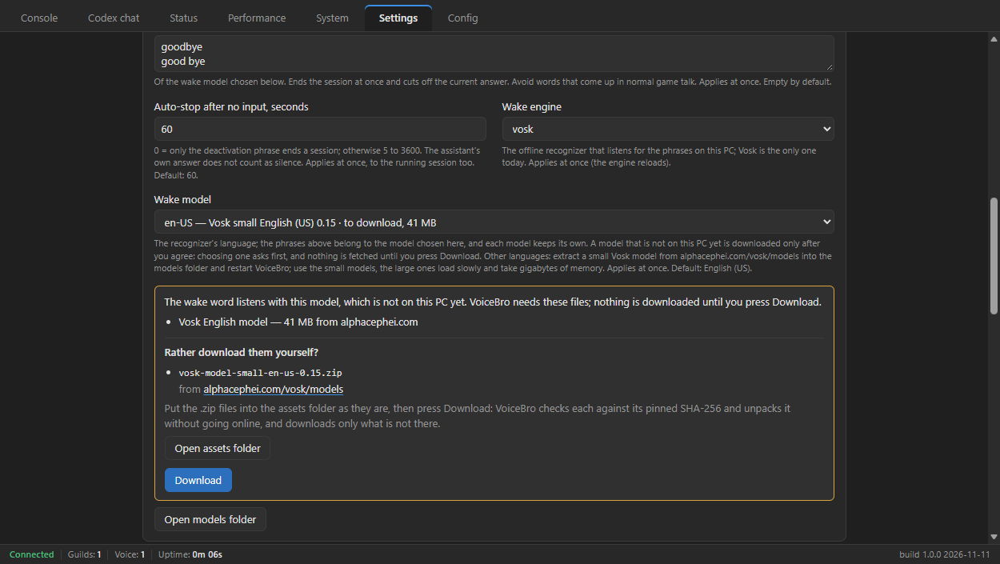

# VoiceBro user guide

How to set up VoiceBro, use it every day and fix the usual problems. For a short overview,
see the [README](../README.md).

## Contents

1. [Create the Discord bot](#1-create-the-discord-bot)
2. [Install VoiceBro](#2-install-voicebro)
3. [Connect the bot](#3-connect-the-bot)
4. [Set up Codex](#4-set-up-codex)
5. [Set the wake phrase](#5-set-the-wake-phrase)
6. [Add another language](#6-add-another-language)
7. [Using VoiceBro](#7-using-voicebro)
8. [Settings](#8-settings)
9. [Privacy and your files](#9-privacy-and-your-files)
10. [Updating](#10-updating)
11. [Uninstalling](#11-uninstalling)
12. [Troubleshooting](#12-troubleshooting)

## 1. Create the Discord bot

VoiceBro talks in your channel through a bot that you create once in Discord's
[Developer Portal](https://discord.com/developers/applications).

1. Press **New Application**, enter a name and press **Create**. People in the channel see
   this name.
2. Open **Bot**. Under **Token**, press **Reset Token** and copy the token. Keep it secret:
   whoever has it controls your bot. Leave the three **Privileged Gateway Intents** off:
   VoiceBro does not use them.
3. Open **Installation**. Keep **Guild Install** among the installation contexts. Under
   **Default Install Settings**, give Guild Install the scopes `bot` and
   `applications.commands`, and the five permissions from the table below.
4. Copy the **Install Link**, open it in your browser, choose **Add to server** and pick
   your server.

The bot needs these permissions:

| Permission | What for |
|---|---|
| **View Channels** | Seeing the voice channel and the text channel where you type `/join`. |
| **Connect** | Joining the voice channel. |
| **Speak** | Playing the assistant's answers in the voice channel. |
| **Send Messages** | Keeping the panel that `/join` posts up to date. VoiceBro edits it whenever the state changes. |
| **Embed Links** | Showing that panel, which is an embed. |

When the bot joins your server, Discord gives it a role with these permissions. A channel's
own permission settings can take them away again: if the bot cannot join or stays silent in
one channel, right-click that channel, choose **Edit Channel → Permissions** and check the
bot's role there. The people who type `/join` need **Use Application Commands**, which
everyone has by default.

## 2. Install VoiceBro

Download one of the two files from the
[latest release](https://github.com/OldSlash/voicebro-discord/releases/latest):

- **The installer**, `VoiceBro_<version>_x64-setup.exe`, installs for your Windows user
  without administrator rights, into `%LOCALAPPDATA%\VoiceBro` unless you choose another
  folder, and adds VoiceBro to the Start menu. On a Windows 10 PC without the Microsoft
  Edge WebView2 Runtime it installs that too.
- **The portable zip**, `VoiceBro_<version>_x64-portable.zip`: extract it into any folder
  and start `voicebro.exe`.

VoiceBro keeps all its files next to `voicebro.exe`, so it needs a folder you can write to.
In a folder such as `C:\Program Files` it shows a message and does not start.

> [!NOTE]
> The releases are not code-signed yet. When Windows shows "Windows protected your PC",
> choose **More info**, then **Run anyway**. To check a file, compare its hash with
> `SHA256SUMS.txt` from the same release:
>
> ```powershell
> Get-FileHash .\VoiceBro_1.0.0_x64-setup.exe -Algorithm SHA256
> ```

## 3. Connect the bot

Start VoiceBro and open the **Config** tab.

1. Paste the token into **Discord bot token** and press **Save changes**. VoiceBro keeps
   the token in the Windows Credential Manager, not in a file, and connects at once and
   at every start.
2. Optionally, put your server's ID into **Discord guild ID** and press **Save changes**.
   The bot's commands then appear in that server right away; otherwise Discord can take up
   to an hour to show them. To copy the ID, turn on **Developer Mode** in Discord
   (**User Settings → Advanced**), right-click your server and choose **Copy Server ID**.

The status bar turns green with **Connected**, and the **Status** tab lists your server.

## 4. Set up Codex

The assistant uses OpenAI's Codex CLI with your ChatGPT account. Open the **Status** tab.

**If Codex is not installed,** the tab says so and offers **Install Codex**. The button runs
the Windows Package Manager (winget) in a console window you can watch: it installs the
package `OpenAI.Codex` from OpenAI's GitHub releases, about 200 MB. Answer winget there if
it asks, press a key when it is done, and VoiceBro finds Codex on its own. Without winget,
install Codex with Node.js (`npm install -g @openai/codex`), or download it from
[the Codex releases](https://github.com/openai/codex/releases) and set the path of
`codex.exe` in **Config → Codex executable**.

**Then sign in:** press **Sign in to Codex**, finish the ChatGPT sign-in in your browser
and press **Check Codex**. The **Codex account** tile shows your account. If you already
use Codex on this PC, **Check Codex** finds that sign-in: VoiceBro uses your normal Codex
installation.

Codex runs only while the bot is in a voice channel, and for a minute after **Sign in to
Codex** or **Check Codex**.

## 5. Set the wake phrase

Open **Settings → Assistant**.



- **Activation** decides when the assistant listens. **Wake word** (the default) starts a
  session when someone says an activation phrase and ends it with a deactivation phrase
  or after the **Auto-stop** time. **Always listening** sends everything said in the
  channel to the assistant while the bot is there.
- **Wake model** is the language of your phrases. English (US) and Russian are built in.
  Each model keeps its own phrases, so switching languages loses nothing.
- **Activation phrases** and **Deactivation phrases** belong to the model chosen below
  them: one per line, or separated by commas. Words the model does not know are listed
  under the field.
- The first time a model is used, VoiceBro shows what it needs to download (the Vosk
  recognizer, 15 MB from github.com, and the model, 41 MB for English or 46 MB for
  Russian, from alphacephei.com) and waits for you to press **Download**.

Good phrases are easy to recognize and rare in game talk:

- Two words work better than one short one. In our tests `hey bro` and `brother` were
  always recognized; a lone `bro` at the start of a sentence was sometimes heard as
  another word.
- If a phrase can be written two ways, add both, for example `goodbye` and `good bye`.
- Keep the deactivation phrase distinct: it cuts off the current answer.

## 6. Add another language

VoiceBro works with any [Vosk model](https://alphacephei.com/vosk/models).

1. Download a **small** model for your language, for example
   `vosk-model-small-de-0.15` for German.
2. In **Settings → Assistant**, press **Open models folder** and extract the zip there, so
   that you get `models\vosk-model-small-de-0.15\am\final.mdl`.
3. Restart VoiceBro. The model appears in **Wake model**, marked "models folder".

Use the small models: the large ones take minutes to load and gigabytes of memory. A model
you add comes with its own license, shown on the models page.

## 7. Using VoiceBro

| In Discord | What happens |
|---|---|
| `/join` | The bot joins your voice channel and replies with a panel that shows its state and a **Mute GPT** button. |
| Say the activation phrase and a question | A session starts and the assistant answers in the channel. |
| Say the deactivation phrase, or stay quiet | The session ends, at once or after the auto-stop time. |
| `/status` | Shows what VoiceBro is doing. |
| `/leave` | The bot leaves the channel. |

**Mute** ends the current session at once and sends nothing until you unmute. Use the
**Mute GPT** button in Discord, the button on the **Status** tab, or the hotkey
**Ctrl+Alt+M**, which works system-wide (change it in **Settings → Hotkey**).

In the window, **Codex chat** shows what the assistant heard, said and looked up, and
**Console** shows what the app is doing.

## 8. Settings

Settings save as soon as you change them. Each one has a short explanation under it in
the window.

| Where | What you set |
|---|---|
| Settings → Appearance | Theme and font size. |
| Settings → Audio | How loud the assistant hears the channel and how loud it speaks; the short tones at session start and end. |
| Settings → Assistant | Wake word or always listening, the phrases, the auto-stop time, the wake model and its download. |
| Settings → Codex | The model and reasoning effort for looked-up answers, the voice, your instructions for the assistant, whether it gets the names of the people in the channel, **Save chat history**. |
| Settings → Hotkey | The mute hotkey. |
| Settings → Diagnostics | **Performance monitoring**, **Memory measurement**, **Verbose log**. All are off by default and cost nothing while off. |
| Config | The Discord bot token, the server ID, the path of `codex.exe` when it is not found on its own. |

## 9. Privacy and your files

What leaves your PC:

- **Between sessions, nothing.** The wake word is recognized locally by Vosk.
- **During a session,** the channel's audio goes to OpenAI through Codex, and the
  assistant's answer is played in the channel. With **Always listening**, a session runs
  the whole time the bot is in the channel.
- **The names of the people in the channel** go to OpenAI at the start of a call, unless
  you turn this off in **Settings → Codex → Speaker names**.
- **Questions the assistant looks up** go to Codex, which may search the web.

Everything VoiceBro stores is in its own folder, next to `voicebro.exe`:

| Item | Contents |
|---|---|
| `settings.json` | Your settings. |
| `logs\` | The app log, at most about 2 MB, without what people said. The chat history too, if you turned on **Save chat history**. |
| `assets\` | The Vosk recognizer and the models VoiceBro downloaded. |
| `models\` | Models you added yourself. |
| `webview-data\` | The window's browser data. |
| `codex-workspace\` | An empty folder Codex works in. |

Outside that folder are only the Discord token in the Windows Credential Manager (entry
`VoiceBro/discord_token`) and your Codex installation with its sign-in in `~\.codex`.

## 10. Updating

Run the new installer. It replaces the program and keeps your settings, models and token.
For the portable zip, replace `voicebro.exe` and keep the rest of the folder.

## 11. Uninstalling

Uninstall VoiceBro in **Windows Settings → Apps**. To remove your settings, logs, models
and the stored token as well, check **Delete the application data** in the uninstaller;
leave it unchecked to keep them for a later install. An installed copy and a portable copy
share the stored token, so deleting the data of one removes the token of both.

Codex stays installed. Remove it with `winget uninstall OpenAI.Codex` if you no longer
need it.

## 12. Troubleshooting

| Problem | What to do |
|---|---|
| The commands do not show up in Discord | Put your server's ID into **Config → Discord guild ID**, or wait up to an hour. |
| `/join` replies "Codex CLI is not installed" or "not signed in" | Do [step 4](#4-set-up-codex); the **Status** tab shows what is missing. |
| The wake phrase does nothing | Look at **Wake word** on the **Status** tab: it says when no phrases are set, when a download waits for you, or which words the model does not know. The **Console** shows a "heard:" line for everything the recognizer understood, so you can pick phrases it hears correctly. |
| The bot joins but does not hear or speak | Check that the bot has **Connect** and **Speak** in that channel, and look for errors in the **Console**. |
| VoiceBro does not start and names a folder | Install or extract it into a folder you can write to, such as `%LOCALAPPDATA%\VoiceBro`. |
| Something else | Turn on **Settings → Diagnostics → Verbose log**, repeat the problem, and attach `logs\voicebro.log` (**Codex chat → Open log folder**) to a [GitHub issue](https://github.com/OldSlash/voicebro-discord/issues). With the verbose log on, the file contains what people said, so read it before you share it. |
