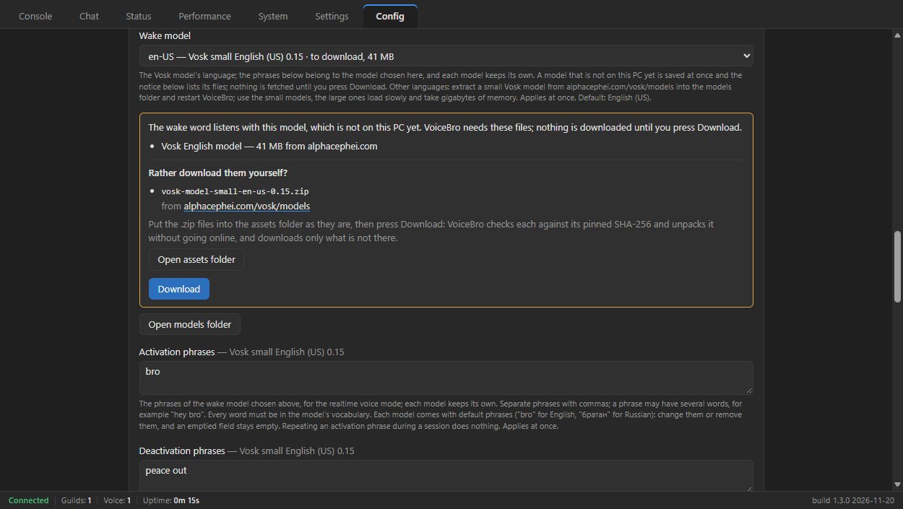

# VoiceBro user guide

How to set up VoiceBro, use it every day and fix the usual problems. For a short overview,
see the [README](../README.md).

## Contents

1. [Create the Discord bot](#1-create-the-discord-bot)
2. [Install VoiceBro](#2-install-voicebro)
3. [Connect the bot](#3-connect-the-bot)
4. [Set up Codex](#4-set-up-codex)
5. [Set the wake phrase](#5-set-the-wake-phrase)
6. [Add another language](#6-add-another-language)
7. [The Whisper mode](#7-the-whisper-mode)
8. [Using VoiceBro](#8-using-voicebro)
9. [Settings](#9-settings)
10. [Privacy and your files](#10-privacy-and-your-files)
11. [Updating](#11-updating)
12. [Uninstalling](#12-uninstalling)
13. [Troubleshooting](#13-troubleshooting)

## 1. Create the Discord bot

VoiceBro talks in your channel through a bot that you create once in Discord's
[Developer Portal](https://discord.com/developers/applications).

1. Press **New Application**, enter a name and press **Create**. People in the channel see
   this name.
2. Open **Bot**. Under **Token**, press **Reset Token** and copy the token. Keep it secret:
   whoever has it controls your bot. Leave the three **Privileged Gateway Intents** off:
   VoiceBro does not use them.
3. Open **Installation**. Keep **Guild Install** among the installation contexts. Under
   **Default Install Settings**, give Guild Install the scopes `bot` and
   `applications.commands`, and the five permissions from the table below.
4. Copy the **Install Link**, open it in your browser, choose **Add to server** and pick
   your server.

The bot needs these permissions:

| Permission | What for |
|---|---|
| **View Channels** | Seeing the voice channel and the text channel where you type `/join`. |
| **Connect** | Joining the voice channel. |
| **Speak** | Playing the assistant's answers in the voice channel. |
| **Send Messages** | Keeping the panel that `/join` posts up to date. VoiceBro edits it whenever the state changes. Posting the assistant's answers, if you turn that on ([section 8](#posting-the-answers-to-discord)). |
| **Embed Links** | Showing that panel, which is an embed, and the previews of the links in a posted answer. |

When the bot joins your server, Discord gives it a role with these permissions. A channel's
own permission settings can take them away again: if the bot cannot join or stays silent in
one channel, right-click that channel, choose **Edit Channel → Permissions** and check the
bot's role there. The people who type `/join` need **Use Application Commands**, which
everyone has by default.

## 2. Install VoiceBro

Download one of the two files from the
[latest release](https://github.com/OldSlash/voicebro-discord/releases/latest):

- **The installer**, `VoiceBro_<version>_x64-setup.exe`, installs for your Windows user
  without administrator rights, into `%LOCALAPPDATA%\VoiceBro` unless you choose another
  folder, and adds VoiceBro to the Start menu. On a Windows 10 PC without the Microsoft
  Edge WebView2 Runtime it installs that too.
- **The portable zip**, `VoiceBro_<version>_x64-portable.zip`: extract it into any folder
  and start `voicebro.exe`.

VoiceBro keeps all its files next to `voicebro.exe`, so it needs a folder you can write to.
In a folder such as `C:\Program Files` it shows a message and does not start.

> [!NOTE]
> The releases are not code-signed yet. When Windows shows "Windows protected your PC",
> choose **More info**, then **Run anyway**. To check a file, compare its hash with
> `SHA256SUMS.txt` from the same release:
>
> ```powershell
> Get-FileHash .\VoiceBro_1.0.0_x64-setup.exe -Algorithm SHA256
> ```

## 3. Connect the bot

Start VoiceBro and open the **Config** tab.

1. Paste the token into **Discord bot token** and press **Save changes**. VoiceBro keeps
   the token in the Windows Credential Manager, not in a file, and connects at once and
   at every start.
2. Optionally, put your server's ID into **Discord guild ID** and press **Save changes**.
   The bot's commands then appear in that server right away; otherwise Discord can take up
   to an hour to show them. To copy the ID, turn on **Developer Mode** in Discord
   (**User Settings → Advanced**), right-click your server and choose **Copy Server ID**.

The status bar turns green with **Connected**, and the **Status** tab lists your server.

## 4. Set up Codex

The assistant uses OpenAI's Codex CLI with your ChatGPT account. Open the **Status** tab.

**If Codex is not installed,** the tab says so and offers **Install Codex**. The button runs
the Windows Package Manager (winget) in a console window you can watch: it installs the
package `OpenAI.Codex` from OpenAI's GitHub releases, about 200 MB. Answer winget there if
it asks, press a key when it is done, and VoiceBro finds Codex on its own. Without winget,
install Codex with Node.js (`npm install -g @openai/codex`), or download it from
[the Codex releases](https://github.com/openai/codex/releases) and set the path of
`codex.exe` in **Config → Codex executable**.

**Then sign in:** press **Sign in to Codex**, finish the ChatGPT sign-in in your browser
and press **Check Codex**. The **Codex account** tile shows your account. If you already
use Codex on this PC, **Check Codex** finds that sign-in: VoiceBro uses your normal Codex
installation.

Codex runs only while the bot is in a voice channel, and for a minute after **Sign in to
Codex**, **Check Codex** or **Refresh lists**. **Check Codex** also reads the models,
reasoning levels and voices of your account; VoiceBro saves them in `codex-lists.json`, so
the lists in **Config → Codex** are there at the next start without starting Codex. The
first start after installing reads them once on its own when Codex is installed.

## 5. Set the wake phrase

This section is about the default mode, **Realtime voice**, where Vosk listens for the wake
phrase. The first field of **Config → Assistant**, **Assistant mode**, chooses the mode, and
the grey **Recognition** field under it shows "Vosk". In the
[Whisper mode](#7-the-whisper-mode) the same card shows the Whisper model and the Whisper
phrases in place of the wake model and its phrases.

Open **Config → Assistant**.



- **Activation** decides when the assistant listens. **Wake word** (the default) starts a
  session when someone says an activation phrase and ends it with a deactivation phrase
  or after the **Auto-stop** time. **Always listening** sends everything said in the
  channel to the assistant while the bot is there.
- **Wake model** is the language of your phrases: English (US, the default), Russian,
  Czech, Dutch, French, German, Italian, Polish, Portuguese (Brazil) or Spanish. None of
  them comes with the installer; each is downloaded once, after you agree. Each model
  keeps its own phrases, so switching languages loses nothing.
- **Activation phrases** and **Deactivation phrases** belong to the model chosen below
  them. Separate phrases with commas; a phrase may have several words, for example
  `Отбой братан, Заканчивай, Братан всё` holds three deactivation phrases. A line break
  separates too. Every word must be in the model's vocabulary: words the model does not
  know are listed under the field. Case and punctuation do not matter, and "ё" counts as
  "е", so `Братан всё` matches when the recognizer writes "братан все".
- **Every model comes with default phrases**, so the wake word works at once. The fields
  show them until you change them:

  | Wake model | Activation | Deactivation |
  |---|---|---|
  | English (US) | bro | peace out |
  | Russian | братан | отбой |
  | Czech | brácha | čau |
  | Dutch | maat | doei doei |
  | French | mon frère | à la prochaine, a la prochaine |
  | German | bruder | bis dann |
  | Italian | fratello | arrivederci |
  | Polish | ziomek | do widzenia |
  | Portuguese (Brazil) | irmão | até mais |
  | Spanish | hermano | hasta luego |

  Each was checked with the small model of its language on spoken samples. A model you
  added to the models folder takes the defaults of its language when its folder name says
  which one, for example `vosk-model-small-de-0.21`; any other starts with empty fields.

  Change a default or remove it: what you type replaces the default of that field only.
  An emptied field stays empty; the default does not come back.
- The deactivation phrase also counts when the assistant's own call hears it: during an
  answer the voice call transcribes what people say, and a deactivation phrase in that
  text ends the session even when the wake word missed it. The voice stops at once and
  the falling tone plays.
- When the wake word's files are not on this PC, the notice under **Wake model** in
  **Config → Assistant** says so, and so does **Wake word** on the **Status** tab. It
  lists what is needed: the Vosk recognizer, 15 MB from github.com, once, and the model,
  32 to 53 MB depending on the language, from alphacephei.com. Starting VoiceBro does not
  interrupt you with it.
- A window, **The wake word is not installed**, asks about the same files when the bot
  joins a voice channel (`/join`), when you switch to **Wake word**, and when you choose
  a model that is not downloaded yet. Nothing is downloaded until you press
  **Download**; the window shows the progress and closes when the files are in place.
- **Not now** closes the window and downloads nothing. The notice under **Wake model**
  keeps its own **Download** button, and the window comes back at the next `/join`. When
  you were choosing a model, **Cancel** keeps the model you had.
- **Rather download the files yourself?** The window and the notice name each file and
  link to the official page it is published on. A link opens in your browser:
  - `vosk-win64-0.3.45.zip`, the recognizer, from its release page on GitHub
    (`github.com/alphacep/vosk-api/releases/tag/v0.3.45`), under **Assets**;
  - the model, for example `vosk-model-small-en-us-0.15.zip` for English, from the Vosk
    models page (`alphacephei.com/vosk/models`). The models are not on GitHub; this page
    is where the Vosk project publishes them.

  Press **Open assets folder** and put the `.zip` files there as they are, without
  unpacking them, then press **Download**. VoiceBro checks each file against the
  checksum it knows for it and unpacks it without going online; the window says
  "Checking and unpacking" instead of "Downloading". Only files that are not in the
  folder are downloaded. A file with the right name that fails the check is deleted, and
  the window says so.

Good phrases are easy to recognize and rare in game talk:

- Two words work better than one short one. In our tests `hey bro` and `peace out` were
  always recognized; a lone `bro` at the start of a sentence was sometimes heard as
  another word.
- If a phrase can be written two ways, add both, for example `goodbye` and `good bye`.
- Check what the model hears. The **Console** shows a "heard:" line for everything the
  recognizer understood; if it writes your phrase differently, use its spelling. In our
  tests the small Czech model heard "kámo" as "samo", the small French model heard
  "tchao" as "tiens" and wrote "a la prochaine" without the accent, and the small
  Portuguese model heard "mano" as "humano", so those are not the defaults.
- Keep the deactivation phrase distinct: it cuts off the current answer.

## 6. Add another language

VoiceBro works with any [Vosk model](https://alphacephei.com/vosk/models), also for a
language that is not in the **Wake model** list.

1. Download a **small** model for your language, for example
   `vosk-model-small-ca-0.4` for Catalan.
2. In **Config → Assistant**, press **Open models folder** and extract the zip there, so
   that you get `models\vosk-model-small-ca-0.4\am\final.mdl`.
3. Restart VoiceBro. The model appears in **Wake model**, marked "models folder".

Use the small models: the large ones take minutes to load and gigabytes of memory. A model
you add comes with its own license, shown on the models page.

## 7. The Whisper mode

VoiceBro has two ways to talk to the assistant. Choose one in **Config → Assistant →
Assistant mode**:

| | Realtime voice (the default) | Whisper |
|---|---|---|
| The wake phrase | Vosk listens for it on your PC. | Whisper writes down what is said on your PC and finds the phrase in that text. |
| Your question | Goes to OpenAI's realtime voice call as audio. | Whisper writes it down on your PC; only the text goes to Codex. |
| The answer | ChatGPT's voice from the call. | Codex answers in text, and a voice on your PC reads it into the channel. |
| What it downloads | Vosk and a wake model, about 50 to 70 MB. | Whisper and a model, and a voice: about 230 MB on the CPU with the defaults, more with an NVIDIA GPU or a larger model. |

Both modes use Codex with your ChatGPT sign-in. Your instructions, **Speaker names**,
**Post answers to Discord**, **Who the assistant hears**, the mute, the tones and the
auto-stop work in both.

> [!NOTE]
> The Whisper mode is new. The timings below come from tests on one PC with recorded
> speech. It has not been tried yet in a real voice channel with several people while a
> game runs.

### What leaves your PC

In the Whisper mode, speech is recognized on your PC and the voice is made on your PC. Only
text goes to OpenAI:

- **between sessions, nothing**: what people say only reaches Whisper, which looks for the
  activation phrase;
- **during a session, the text of every question**, with the speaker's name at its start
  unless **Speaker names** is off;
- **the names of the people in the channel**, with the first question of a session, unless
  **Speaker names** is off;
- **the earlier questions and answers of this run of VoiceBro**, as text, when Codex starts
  a new conversation thread: at a `/join` after the bot had left every channel, or after
  you changed the Codex model or reasoning.

With **Always listening**, everything said in the channel goes to Codex as text, the whole
time the bot is in it.

### Where the settings are

The Whisper mode's settings sit with the others: what the bot does is on the **Config** tab,
how Whisper runs on this PC is on the **Settings** tab. Every field saves as soon as you
change it. All of them but the Whisper model and the Whisper phrases, which show only in
the Whisper mode, can be changed in either mode.

- **Config → Assistant**: **Assistant mode** first, then the grey **Recognition** field,
  which shows "Vosk" or "Whisper" and follows the mode. In the Whisper mode the card shows
  the **Whisper model** with its download notice and **Download**, and the Whisper mode's
  **Activation phrases** and **Deactivation phrases**, where the realtime mode shows the
  wake model and its phrases. **Activation** (wake word or always listening) and the
  auto-stop stay below, shared by both modes.
- **Config → Local voice**, the card after Assistant: **Voice**, **Speed**, **Preview** and
  the voice's download notice with **Download**. A note on top says whether the voice is in
  use: in the realtime mode it is not, because the Codex call speaks with its own voice, but
  you can choose and download one now.
- **Settings → Whisper**, the card after Diagnostics: an **On** or **Off** label that
  follows the mode (switch it in **Config → Assistant**), **Device**, **CPU threads**,
  **Language**, a line with what is in use and the timings of the last answer, and **Open
  Whisper models folder**.

### Downloads

Nothing of the Whisper mode comes with the installer. What is needed depends on what you
choose:

| File | Size | From |
|---|---|---|
| The Whisper runtime for the CPU | 9 MB | github.com |
| Or, for **NVIDIA GPU**, the Whisper runtime with CUDA 12.4 (it holds the CPU runtime too) | 685 MB, about 1.15 GB unpacked | github.com |
| The voice activity model, which keeps noise away from Whisper | 0.9 MB | huggingface.co |
| The Whisper model you choose | 44 MB to 1.6 GB | huggingface.co |
| The voice engine sherpa-onnx, for every voice but the Windows ones | 8 MB | github.com |
| The voice you choose: Supertonic 3 (ten voices), a Piper voice or Kokoro English (eleven voices) | 129 MB; 67 to 116 MB; 320 MB | github.com |
| The phonemizer piper-phonemize, only for Piper and Kokoro voices | 0.4 MB | github.com |

Nothing is downloaded until you press **Download**, and you can download in either mode.
Each notice lists what is still missing, with each size, and its **Download** fetches only
that:

- **Config → Assistant**, under the Whisper model (in the Whisper mode): the runtime, the
  model and the voice activity model;
- **Config → Local voice**, under the voice: the voice engine, the phonemizer when the
  voice needs it, and the voice;
- **Settings → Whisper**: in the realtime mode, everything the Whisper model chosen for the
  Whisper mode still needs on the chosen device, so you can download it all before you
  switch; in the Whisper mode, the NVIDIA runtime under **Device** when you chose the GPU
  and it is not here yet.

A download in the realtime mode only installs the files; nothing is loaded until you use
the Whisper mode. The consent counts for this choice only: another model, device or voice
asks again for what it adds.

In the Whisper mode, a window, **The Whisper mode is not installed**, lists everything your
model, device and voice still need, with each size and the total. It opens:

- when `/join` is refused because files are missing; the bot then replies "Not joined: The
  Whisper mode needs downloads: open VoiceBro → Config and press Download in the Assistant
  and Local voice cards";
- when you switch to the Whisper mode and files are missing;
- when you choose a Whisper model, a device or a voice that is not on this PC yet. Nothing
  is saved until you press **Download**, and **Cancel** keeps what you had.

In the realtime mode such a choice is saved at once, and its card shows the notice instead.
Starting VoiceBro never opens the window. **Not now** closes it; the notices keep their
**Download** buttons.

**Rather download the files yourself?** As for the wake word (section 5), the window and
the notices name each file and link to the page it is published on. Press **Open assets
folder** and put the files there as they are, without unpacking them, then press
**Download**. A Whisper model must have the file name the window shows: some models are
published as `ggml-model.bin`, so rename the file after the download.

### CPU or NVIDIA GPU

These are in **Settings → Whisper**.

- **Device**: **CPU** (the default) or **NVIDIA GPU (CUDA)**. The GPU needs an NVIDIA
  graphics card with its driver and the larger runtime download. In the Whisper mode its
  notice and **Download** appear under **Device**; in the realtime mode it is part of the
  card's notice. Whisper on AMD or Intel graphics is not available.
- Without a usable NVIDIA card, Whisper runs on the CPU. The line on the **Whisper** card
  then reads "GPU requested, CPU used" with the reason, and so does the **Whisper device**
  tile on the **Status** tab.
- If Whisper already ran on the CPU since VoiceBro started and you then download the GPU
  runtime, restart VoiceBro to use the GPU.
- The very first answer after you install the GPU runtime can take about half a minute,
  while the graphics driver prepares Whisper's code. The driver keeps the result, so later
  starts are quick.
- **CPU threads**: 0 (the default) picks half of your processor's threads, at most 16. It
  counts only while Whisper runs on the CPU.
- The voice always runs on the CPU.

### Choosing a model

Choose the Whisper model in **Config → Assistant** while the mode is Whisper. In the
realtime mode the choice is kept, and while it misses files the notice on **Settings →
Whisper** names it (base (q8_0) until you choose another). The model decides how well Whisper hears and how long you wait after a question. Whisper
always works on a 30-second window, so a short phrase takes almost as long as a long one.
In our tests on a gaming laptop (Intel Core Ultra 9 275HX with 24 threads, NVIDIA GeForce
RTX 5090 Laptop GPU), one utterance took:

| Model | On the CPU | On the NVIDIA GPU |
|---|---|---|
| tiny (q8_0), 44 MB | 0.25 s | |
| base (q8_0), 82 MB, the default | 0.55 s | |
| small (q8_0), 264 MB | 1.7 to 1.8 s | |
| medium (q5_0), 539 MB | 6 to 9.5 s | |
| large-v3-turbo (q5_0), 574 MB | 11 s | 0.12 to 0.14 s |

- **With an NVIDIA GPU, choose large-v3-turbo (q5_0).** It hears well and takes about a
  tenth of a second. It holds about 0.8 GB of video memory while the bot is in a channel.
- **On the CPU, choose base** for quick answers, or **small** if base mishears you and your
  processor is fast. Medium and the large models are too slow on a CPU for a conversation.
  A slower processor than ours takes longer.
- **English only** models (base.en, small.en, distil-large-v3.5) hear only English.
- **Russian-tuned** models are community fine-tunes of large models for Russian speech; use
  them on a GPU.
- **Your models**: put any ggml Whisper model (a `.bin` file) into the `whisper-models`
  folder (**Settings → Whisper → Open Whisper models folder**) and restart VoiceBro. It
  appears under **Your models**. VoiceBro never changes that folder. A model you add comes
  with its own license.
- **Language** (**Settings → Whisper**): **Automatic** lets Whisper detect the language of
  every utterance. A fixed language is quicker and more exact on short phrases.

The line on **Settings → Whisper** shows the last answer's timings: from the end of the
question to the text, from the text to Codex's first words, and from those to the voice.

### Phrases

In the Whisper mode, the phrase fields of **Config → Assistant** hold the Whisper mode's own
phrases, kept apart from the wake models' phrases; switching back to realtime voice shows
the wake model's phrases again, and both sets are kept. Whisper writes any word, so a
phrase may be any word or several words in a row; there is no vocabulary check. Separate
phrases with commas or line breaks. Case and punctuation do not matter, and "ё" counts as
"е". Until you change a list, the defaults are **bro** and **peace out**, whatever the
language.

How Whisper's phrases work:

- Whisper writes down an utterance once its speaker has paused for 0.7 s. The activation
  phrase counts a moment after you stop talking, not while you speak.
- Say the phrase and the question in one breath: "hey bro, what is the weather in Bangkok?"
  starts the session and asks the question. The phrase alone starts the session with the
  rising tone, and your next sentence is the question.
- **During a session, everything anyone says is a question**, and a new question cuts off
  the answer in progress, as speaking during a realtime call does. Keep side talk out of a
  session, or end it.
- A deactivation phrase anywhere in a sentence, as in "ok thanks, peace out", ends the
  session at once and cuts off the answer. The words before it are not sent.
- With **Always listening**, everything said is a question, and the phrases are not used.
- A voice activity check runs before Whisper, to keep silence and game sounds from turning
  into text.
- Whisper gets your phrases as a hint, so it spells them the way you typed them.

Two words work better than one short one, and the deactivation phrase should not come up
in normal game talk. The **Console** shows a "heard" line for everything Whisper wrote down.

### The voice

Choose it in **Config → Local voice**.

| Voice | Languages | Notes |
|---|---|---|
| **Supertonic 3**, F1 to F5 and M1 to M5 (the default is F1) | 31, among them all ten wake languages | Reads each answer in the language of the question. The first words come about half a second after Codex's first sentence. |
| **Piper** | One each: English, Russian, Czech, Dutch, French, German, Italian, Polish, Portuguese, Spanish | The quickest. Needs the phonemizer. |
| **Kokoro English** | English | Eleven voices. Needs the phonemizer. |
| **Windows** | The speech languages your Windows has | No download and instant, but robotic. A Windows speech pack adds languages. |

The voice list shows each voice's data license. Supertonic 3 is under BigScience
OpenRAIL-M, which allows commercial use but comes with use restrictions; the phonemizer
that Piper and Kokoro need, piper-phonemize, is GPL-3.0 and a separate download.
`THIRD-PARTY-NOTICES.txt` lists them all.

- **Speed**: 0.5 to 2 times the voice's own pace. It applies from the next answer and to
  **Preview**.
- **Preview** reads a short sample sentence about the weather in London in the voice's
  language (in English for Supertonic 3) and plays it in the window only, never in Discord.
  The voice's files must be on this PC.
- The voice starts while Codex is still writing, after its first sentence. Every message
  Codex writes is read, also a short "let me check that" before a web search.
- Code and tables are not read, and a link is read as its site's name. A posted answer
  ([section 8](#posting-the-answers-to-discord)) keeps them.

In the Whisper mode Codex answers every question itself, so **Model** and **Reasoning** in
**Config → Codex** set how quickly each answer comes: a low reasoning level is the quick
choice. **Voice** and **Answer handoff** there are for the realtime mode only.

### Switching modes

A change of **Assistant mode** applies at once, also while the bot is in a voice channel:
a running session ends with the falling tone, the bot stays in the channel, and the next
session uses the new mode.

- Switching to Whisper loads Whisper and the voice in the background; the line on
  **Settings → Whisper** shows it. If files are missing, the download window asks first.
  Downloading them beforehand, in the realtime mode, avoids the wait.
- Switching back to realtime voice unloads them.
- **Config → Assistant** swaps its rows with the mode: the wake model and its phrases in the
  realtime mode, the Whisper model and the Whisper phrases in the Whisper mode. Each keeps
  its values for the way back.

The Whisper model and the voice load when the bot joins a voice channel, so `/join` takes a
moment longer, and they are unloaded half a second after the bot leaves its last channel.
Between joins they are not in memory; only the libraries that run them stay loaded until
VoiceBro closes.

In Discord, `/status` says "Mode: Whisper mode." or "Mode: Realtime voice.", and the panel
that `/join` posts shows the same under **Mode**.

## 8. Using VoiceBro

| In Discord | What happens |
|---|---|
| `/join` | The bot joins your voice channel and replies with a panel that shows its state and a **Mute GPT** button. |
| Say the activation phrase and a question | A session starts and the assistant answers in the channel. |
| Say the deactivation phrase, or stay quiet | The session ends, at once or after the auto-stop time. |
| `/status` | Shows what VoiceBro is doing, and the mode: realtime voice or Whisper. |
| `/leave` | The bot leaves the channel. |

**Mute** ends the current session at once and sends nothing until you unmute. Use the
**Mute GPT** button in Discord, the button on the **Status** tab, or the hotkey
**Ctrl+Alt+M**, which works system-wide (change it in **Config → Hotkey**).

In the window, **Codex chat** shows what the assistant heard, said and looked up, and
**Console** shows what the app is doing.

### Posting the answers to Discord

When the assistant hands a question to Codex (a web search, a recipe, a price), Codex
writes a full answer with facts, lists and links, and the voice only retells it. VoiceBro
can post that full answer as text in a Discord channel, while the voice is still speaking,
so everyone can read it, open its links and see their previews. Only Codex's final answer
is posted: not its "I'll look that up", not what the voice says and not what people say.
A long answer comes as several messages; a table comes as a block of fixed-width text so
its columns line up. Nobody is pinged, even if the answer contains `@everyone` or a name.

In the [Whisper mode](#7-the-whisper-mode) Codex answers every question itself, so every
answer it finishes is posted, with the question as its first line. An answer cut off by a
new question or by the deactivation phrase is not posted.

Turn it on in **Config → Codex → Post answers to Discord**. It is off by default, because a
posted answer is public in that channel and stays there. Choose where the answers go:

- **The voice channel's chat.** Every voice channel has its own text chat, opened with the
  speech-bubble icon next to the voice channel. Nothing more to set up: the answers follow
  the bot into whatever channel `/join` puts it.
- **The channel of /join.** The answers go where you typed `/join`, under the panel. Type
  `/join` in the text channel you want them in. Typed in the voice channel's own chat, this
  is the same as the voice channel's chat.
- **A chosen channel.** One channel for every answer, for example a channel `#answers`.
  1. Create the channel in Discord. If it is private, add the bot's role to it.
  2. In VoiceBro, choose **A chosen channel**, then pick the channel from **Answers
     channel** below it. The list shows the text channels of the servers the bot is in,
     while the bot is connected. Nothing is saved until you pick one.
  3. A channel marked **(can't post)** lacks one of the permissions below for the bot.
     Fix them in Discord; the mark goes the next time you open the **Config** tab.

  Only answers from that channel's server go there; while the bot is in a voice channel of
  another server, nothing is posted at all.

For every destination the bot needs **View Channels**, **Send Messages** and **Embed
Links** in that channel. They are among the five permissions of the install link, but a
channel's own settings can take them away. If the answers do not appear in one channel,
right-click that channel, choose **Edit Channel → Permissions** and check the bot's role.
When Discord refuses an answer, the **Status** tab shows an `answers` error that names
the channel and the reason; the next answer that gets through clears it. A change of the
setting applies from the next answer. An answer Codex is still looking up when someone
types `/leave` is not posted.

### Who the assistant hears

**Config → Access → Who the assistant hears** decides whose voice reaches the wake word and
the assistant. All three choices are optional tools for you as the person who runs the bot;
which one you use is up to you.

- **Everyone** (the default): every member in the bot's voice channel.
- **People who agreed (/optin)**: your linked Discord account and everyone who ran `/optin`
  in Discord and pressed **I agree**. Nobody else's voice starts a session or gets into a
  question, and neither does a music bot's.
- **Only my Discord account**: the account you linked, nobody else. The assistant runs on
  your own ChatGPT subscription, and a subscription is meant for one person.

Everything else stays open in every mode: anyone can use `/join`, `/leave`, `/status` and
the **Mute GPT** button, everyone in the channel hears the answers, and posted answers are
posted as before. A change applies at once, also while the bot is in a channel.

The bot is yours, so Discord's rules for bots are yours to keep: Discord's developer terms
ask every bot for a privacy policy that people can reach, and for a person's own consent
before their speech is shared with someone else (here, OpenAI). VoiceBro gives you the
tools for both:

1. Write your bot's privacy policy from the template `docs/PRIVACY-POLICY-TEMPLATE.md` in
   VoiceBro's repository, publish it at a public `https://` address (a GitHub Gist works),
   and put that address into **Privacy policy URL** in the Access card and into **Privacy
   Policy URL** of your application in the Discord Developer Portal.
2. Choose **People who agreed**.
3. Ask your friends to run `/optin` in a server with the bot or in a direct message to it.
   Only they see the bot's reply: what is sent after the activation phrase, to whom, what
   is kept, and a link to your policy, with **I agree** and **Cancel**. **I agree** adds
   them to the list in the Access card, with the time.
4. `/optout` takes a person off the list at once and deletes their record; so does
   **Remove** next to them in the card (the bot sends them nothing). `/privacy` shows your
   policy to anyone.

Without a privacy policy URL, `/optin` is refused and the card warns you. The records are
kept in `consents.bin`, encrypted for your Windows user. If VoiceBro changes the consent
text in an update, the old records are removed and people run `/optin` again, since they
agreed to the old text. The filter works on each person's own Discord stream: a voice that
someone else's microphone picks up (a friend sitting next to them, or speakers without
headphones) passes with theirs.

New slash commands can take up to an hour to appear in other servers and in direct
messages; in the server set as **Discord guild ID** they appear at once.

### Only my Discord account

To link your account:

1. Sign in to Codex (section 4).
2. In **Config → Access**, press **Link my Discord account**. VoiceBro reads your Codex
   account and shows a code, for example `K7QF-2M9X`, for 10 minutes.
3. In Discord, from your own account, send `/link` with that code, in any server the bot is
   in or in a direct message to the bot. Only you see the bot's reply. Upper or lower case
   and the dash do not matter.
4. The card shows your Discord name. Choose **Only my Discord account** (or **People who
   agreed**, where your linked account needs no `/optin`).

The code works once. Five wrong codes, from anyone, end it; press **Link** for a new one.
After a first install, `/link` can take up to an hour to appear in direct messages; in the
server set as **Discord guild ID** it appears at once.

The link stays until you press **Unlink**, link another Discord account, sign Codex into
another ChatGPT account, or delete VoiceBro with its data. When Codex is signed into another
account, the card shows "Not linked: the Codex account changed"; link again. While **Only my
Discord account** is chosen and no account is linked, the assistant hears nobody.

## 9. Settings

The **Settings** tab holds the window's own settings and how Whisper runs on this PC; the
**Config** tab holds the bot's.
Settings save as soon as you change them, except the three fields of **Config → Discord
and Codex**, which wait for **Save changes**. Each one has a short explanation under it in
the window. On both tabs, click a card's title to fold it away or open it again; VoiceBro
remembers which cards are folded.

| Where | What you set |
|---|---|
| Settings → Appearance | Theme and font size. |
| Settings → Diagnostics | **Performance monitoring**, **Memory measurement**, **Verbose log**. All are off by default and cost nothing while off. **Opus codec (experiment)**: which Opus implementation encodes and decodes the voice (the assistant toward Discord, your speech toward Codex and its answer, the people in the channel): libopus, the C library VoiceBro has always used and the default, or opus-rs, written in Rust and being tried as its replacement. A change applies at the next `/join` and the next call; the line under the list shows the codec in use. |
| Settings → Whisper | Whether the Whisper mode is on (it is switched in Config → Assistant), CPU or NVIDIA GPU, the CPU threads, the language, what is in use and the last answer's timings, the Whisper models folder, and, in the realtime mode, the download of the Whisper files ahead of the switch ([section 7](#7-the-whisper-mode)). |
| Config → Discord and Codex | The Discord bot token, the server ID, the path of `codex.exe` when it is not found on its own. Press **Save changes**. |
| Config → Access | **Who the assistant hears** (Everyone by default, People who agreed, Only my Discord account), **Privacy policy URL**, the link to your Discord account and the people who agreed with `/optin` ([section 8](#who-the-assistant-hears)). |
| Config → Audio | How loud the assistant hears the channel and how loud it speaks; the short tones at session start and end. |
| Config → Assistant | **Assistant mode** (realtime voice, the default, or Whisper) and the grey **Recognition** field; wake word or always listening, the phrases, the auto-stop time, and the model with its download: the wake model in the realtime mode, the Whisper model in the Whisper mode, each with its own phrases. |
| Config → Local voice | The voice that reads the answers in the Whisper mode, its speed, **Preview**, and its download. Not used in the realtime mode. |
| Config → Codex | The model and reasoning effort for looked-up answers (in the Whisper mode, for every answer), the voice of the realtime call, your instructions for the assistant, whether it gets the names of the people in the channel, **Save chat history**, **Post answers to Discord** and the channel for it ([section 8](#posting-the-answers-to-discord)). The model, reasoning and voice lists come from the last time VoiceBro read them from Codex; the card says when that was. **Refresh lists** reads them now, and **Refresh the lists at start** (off by default) reads them at every start of VoiceBro. |
| Config → Hotkey | The mute hotkey. |

The bottom of the **Config** tab shows where `settings.json` is.

## 10. Privacy and your files

What leaves your PC:

- **Between sessions, nothing.** The wake word is recognized locally, by Vosk or, in the
  Whisper mode, by Whisper.
- **During a session,** the channel's audio goes to OpenAI through Codex, and the
  assistant's answer is played in the channel. In the Whisper mode only the text of the
  questions goes, and the answer is read by a voice on your PC
  ([section 7](#what-leaves-your-pc)). With **Always listening**, a session runs the whole
  time the bot is in the channel.
- **The names of the people in the channel** go to OpenAI at the start of a call, unless
  you turn this off in **Config → Codex → Speaker names**.
- **Questions the assistant looks up** go to Codex, which may search the web.
- **Codex's answers to those questions** are posted in Discord, if you turned on **Post
  answers to Discord**. Everyone who can read that channel sees them, and they stay in its
  history until someone deletes them.

Everything VoiceBro stores is in its own folder, next to `voicebro.exe`:

| Item | Contents |
|---|---|
| `settings.json` | Your settings. |
| `owner-link.bin` | The Discord account you linked, encrypted so that only your Windows user on this PC can read it. Only if you linked one. |
| `consents.bin` | The people who agreed with `/optin`: their Discord account, name and the time they agreed, encrypted so that only your Windows user on this PC can read it. Only while someone has agreed. |
| `codex-lists.json` | The Codex models, reasoning levels and voices of your account, from the last time VoiceBro read them. |
| `logs\` | The app log, at most about 2 MB, without what people said. The chat history too, if you turned on **Save chat history**. |
| `assets\` | What VoiceBro downloaded: the Vosk recognizer and its models, and for the Whisper mode the Whisper runtime and models and the voices. |
| `models\` | Vosk models you added yourself. |
| `whisper-models\` | Whisper models you added yourself. |
| `webview-data\` | The window's browser data. |
| `codex-workspace\` | An empty folder Codex works in. |

Outside that folder are only the Discord token in the Windows Credential Manager (entry
`VoiceBro/discord_token`) and your Codex installation with its sign-in in `~\.codex`.

## 11. Updating

Run the new installer. It replaces the program and keeps your settings, models and token.
For the portable zip, replace `voicebro.exe` and keep the rest of the folder.

## 12. Uninstalling

Uninstall VoiceBro in **Windows Settings → Apps**. To remove your settings, logs, models
(the Whisper models and voices too), the linked Discord account and the stored token as
well, check **Delete the application data** in the uninstaller;
leave it unchecked to keep them for a later install. An installed copy and a portable copy
share the stored token, so deleting the data of one removes the token of both.

Codex stays installed. Remove it with `winget uninstall OpenAI.Codex` if you no longer
need it.

## 13. Troubleshooting

| Problem | What to do |
|---|---|
| The commands do not show up in Discord | Put your server's ID into **Config → Discord guild ID**, or wait up to an hour. |
| `/join` replies "Codex CLI is not installed" or "not signed in" | Do [step 4](#4-set-up-codex); the **Status** tab shows what is missing. |
| The wake phrase does nothing | Look at **Wake word** on the **Status** tab: it says when the model still waits for its download (press **Download** under **Wake model** in **Config → Assistant**, or put the files there yourself as section 5 describes), when no phrases are set, or which words the model does not know. The **Console** shows a "heard:" line for everything the recognizer understood, so you can pick phrases it hears correctly. |
| The bot joins but does not hear or speak | Check that the bot has **Connect** and **Speak** in that channel, and look for errors in the **Console**. |
| The answers are not posted in Discord | Check **Config → Codex → Post answers to Discord**. In the realtime mode only answers Codex looked up are posted, not what the voice answers on its own. With **A chosen channel**, only answers from that channel's server go there. Look for an `answers` error on the **Status** tab: it names the channel and what Discord refused, usually a missing **Send Messages** or **Embed Links** ([section 8](#posting-the-answers-to-discord)). |
| `/join` replies "The Whisper mode needs downloads" | The Whisper model, its runtime or the voice is not on this PC yet. Press **Download** in the window that opens in VoiceBro, or in the notices of **Config → Assistant** and **Config → Local voice**, or put the files there yourself ([section 7](#downloads)). Then `/join` again. |
| Whisper runs on the CPU although you chose the NVIDIA GPU | The line on **Settings → Whisper** and the **Whisper device** tile on the **Status** tab say why: no NVIDIA graphics card or driver, the GPU runtime not downloaded yet, or the CPU runtime was already in use since VoiceBro started, in which case restart VoiceBro. |
| Answers in the Whisper mode come slowly | Look at the last answer's timings on **Settings → Whisper**. A long time from the end of speech to the text means the Whisper model is too slow for this PC: choose a smaller model in **Config → Assistant**, or the NVIDIA GPU. A long time from the text to Codex's first words is Codex: choose a lower **Reasoning** in **Config → Codex**. |
| In the Whisper mode, side talk cuts off the answers | During a session everything said is a question, and a new question replaces the one being answered. End the session with the deactivation phrase before you talk among yourselves, or use **Mute**. |
| The wake phrase does nothing in the Whisper mode | Look at **Whisper** on the **Status** tab: the model must be loaded. The **Console** shows a "heard" line for everything Whisper wrote down; if it writes your phrase differently, use its spelling, or pick a two-word phrase. Choose your language in **Settings → Whisper → Language** instead of **Automatic** if Whisper mixes languages up. |
| A link in a posted answer has no preview | Discord shows no preview for a link the answer puts in parentheses, as in "(source: link)". The link itself works. |
| The assistant's voice stutters in places | The ping from the PC that runs VoiceBro to the channel's Discord voice server is probably too high: at around 300 ms or more the voice can break up. Set the channel's **Region Override** (**Edit Channel → Overview**) to a region close to that PC. See [Limitations](../README.md#limitations). |
| A window says "The bot left the voice channel" and "opus-rs failed while …" | The Opus codec opus-rs, which you chose in **Settings → Diagnostics → Opus codec (experiment)**, failed, so the bot left that channel instead of playing broken sound. The window names the server, the channel and the error. Run `/join` to bring it back, or choose libopus there to go back to the default codec. Please attach `logs\voicebro.log` (**Open log folder** in that window) to a [GitHub issue](https://github.com/OldSlash/voicebro-discord/issues). |
| VoiceBro does not start and names a folder | Install or extract it into a folder you can write to, such as `%LOCALAPPDATA%\VoiceBro`. |
| Something else | Turn on **Settings → Diagnostics → Verbose log**, repeat the problem, and attach `logs\voicebro.log` (**Codex chat → Open log folder**) to a [GitHub issue](https://github.com/OldSlash/voicebro-discord/issues). With the verbose log on, the file contains what people said, so read it before you share it. |
